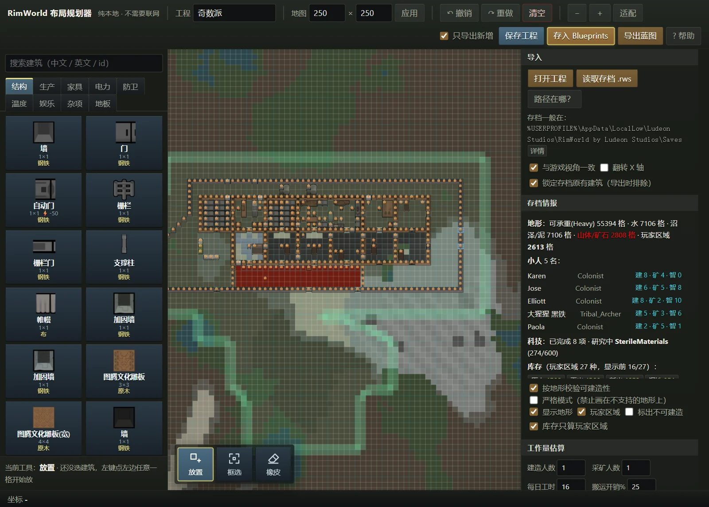
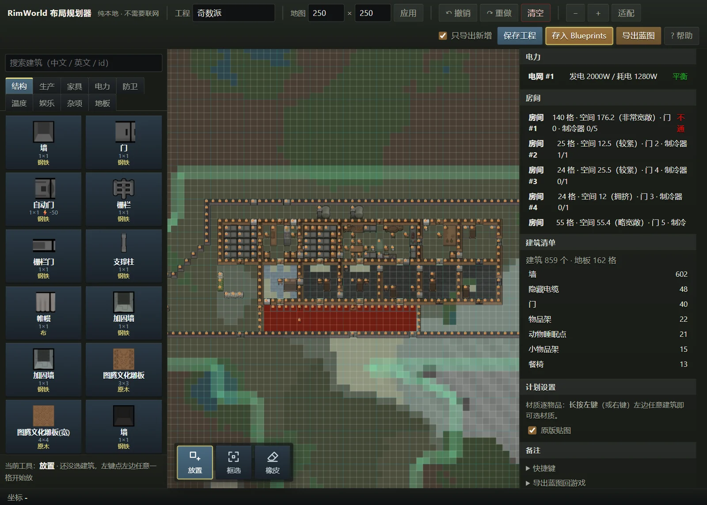
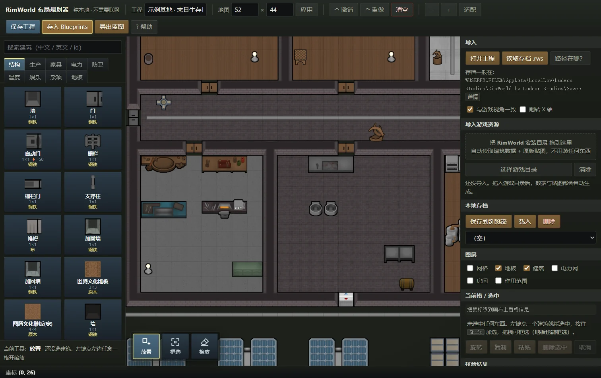
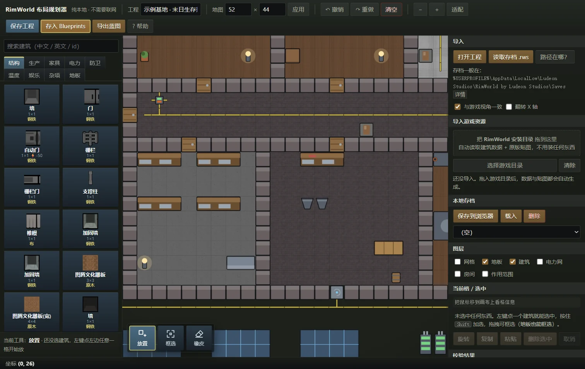

# RimWorld Layout Planner (offline, local)

**Plan a RimWorld base in your browser — no game running, no internet — then run layout checks and export a real blueprint into the game.**


[中文说明](README.md) · [Documentation](docs/) (Chinese)



---

## What it is

A browser-based **layout planner for RimWorld bases**. Place buildings on the real grid footprint, run a pass of layout checks, then export a `.xml` blueprint you can drop back into the game.

- **Correct footprints** — 250×250 grid (configurable), `R` to rotate; multi-cell buildings (beds, tables, fabrication benches) change footprint with rotation
- **Layout checks** — overlap · power network · room detection & space rating · reachability · room roles & temperature estimate
- **Export to game** — real Blueprints-mod `.xml`, **including each building's material and rotation**; workers will build it for real
- **Import your save** — load an existing `.rws` colony as a backdrop and keep planning; it also reads the map **terrain/mountain**, **colonist skills**, **research progress** and **stored materials**
- **Terrain-aware checks** — marsh only has the Light affordance (walls need Heavy), water needs a bridge first, mountain rock must be mined
- **Workload estimate** — combines colonist skills, research prerequisites and stockpile to tell you whether a blueprint is feasible, how much material it needs and roughly how many in-game days it takes
- **Lock the backdrop** — save-imported buildings are locked by default (no accidental edits) and excluded from the blueprint export, so you only ship your new plan
- **Player home area** — reads `Area_Home` and draws it in green; stockpile counts default to the player area (switchable to whole-map)
- **Click room to locate** — clicking a room in the room list jumps the view to it
- **First-run import prompt** — on first launch the app asks once to import your RimWorld folder (with a "don't remind me" option); the import panel stays available
- **Chinese UI** — building and material names match the game (built-in table, or the official Simplified Chinese language pack if present)
- **Optional vanilla textures** — drop your RimWorld install folder into the page and the canvas shows the real game art; skip it and you get clean vector fallbacks

> **What it is not**: not a mod, it does not touch your game files, it does not go online, and it uploads nothing. Its only output is a blueprint file.

## Quick start

Pick one of three:

### 1. Try it online (zero install)

👉 **https://luwendi-qq.github.io/rimworld-planner/**

Fully functional. The only catch: you must drag in your RimWorld folder once if you want vanilla textures (they are cached locally in your browser).

### 2. Download the single-file build (recommended for daily use)

Grab `rimworld-planner.single.html` from [Releases](https://github.com/luwendi-qq/rimworld-planner/releases/latest) and **just double-click it**.

CSS and all JS are inlined into this one file — no external dependencies, roughly 630 KB, copy it anywhere.

### 3. Clone the source (follow updates / hack on it)

```bash
git clone https://github.com/luwendi-qq/rimworld-planner.git
```

Then pull future updates with:

```bash
git pull
```

Or click **Code → Download ZIP** on the repo page and overwrite your old folder.

> The `img/` textures are **not** in this repository (licensing — see below), so a fresh clone shows vector art. **Everything still works.** To get vanilla visuals, see [docs/textures.md](docs/textures.md) — it is a one-time local step.

## Highlights

| Feature | Notes |
| --- | --- |
| **Smart draw modes** | Walls/fences/sandbags → **rectangle outline**; doors/furniture/benches → **single cell**; floors → **fill**. Matches the game, no manual switching |
| **Never silently overwrites** | Drawing onto an existing building is blocked ("delete that tile first") instead of quietly replacing your plan; conduits can still go under walls and coolers / wall lamps can share a tile with a wall |
| **Auto-connecting conduits** | Conduits draw connections toward their neighbours; a lone tile becomes a junction box |
| **Per-item materials** | 53 stuffs (wood/stone/metal/fabric/leather), long-press to pick, remembered per building — and imported from your save |
| **Room roles** | Tag a room as bedroom / kitchen / workshop / cold storage / freezer; checks then verify the room has what it needs and how many coolers its target temperature calls for |
| **Template library** | Save a selection as a named template (standard bedroom, dining room…) and stamp it out with one click instead of drawing it dozens of times |
| **Layout checks** | Power network via the game's 6-tile connection rule; room flood-fill with the game's space-rating thresholds; outdoor reachability via BFS |
| **Export image** | "View PNG" exports what you see, "Full PNG" auto-fits the whole layout — handy for sharing |
| **Standard editing** | Marquee select, multi-select, drag to move, copy/paste, delete, undo/redo (incremental, 200 steps, no memory blow-up on big bases) |
| **Search** | By Chinese name, English name, or def id |

Full manual → [docs/usage.md](docs/usage.md) (Chinese)

## Screenshots

### Layout check: power network



Turn on the **电力网 (power grid)** layer to see the wiring: **thick yellow lines are conduit trunks, thin lines are devices joining the grid**.
The 运行校验 (Run checks) button also reports each grid's generation / draw / storage balance, plus every room's area, space rating, door count and cooler coverage.

### Vanilla textures vs vector fallback

Same area: the top image uses the game's vanilla textures, the bottom one is the vector fallback you get without `img/`.
**Shapes, footprints and rotations are identical** — only the game art is missing:





## Getting the blueprint into the game

Click **导出蓝图 (Export blueprint)** in the top bar to get a `.xml`, then drop it into your Blueprints folder:

| Platform | Path |
| --- | --- |
| Windows | `%USERPROFILE%\AppData\LocalLow\Ludeon Studios\RimWorld by Ludeon Studios\Blueprints\` |
| Linux | `~/.config/unity3d/Ludeon Studios/RimWorld by Ludeon Studios/Blueprints/` |
| macOS | `~/Library/Application Support/RimWorld/Blueprints/` |

Load it in-game with the blueprint button; workers will consume materials and build it. Requires the **Blueprints** mod (for 1.7: `Blueprints - 1.7 Waylith (Unofficial)`, workshop ID `3819556044`).

> Handy: click **存入 Blueprints (Save into Blueprints)**, pick the folder once, and future exports write straight into it.

Details and save importing → [docs/import-export.md](docs/import-export.md) (Chinese)

## Data accuracy (important)

The built-in database is **hand-curated reference data**: footprints are mostly reliable, but a few entries may drift between game versions. Those are flagged with `?` in the UI.

**Want exact numbers** (size / power usage / generation / storage straight from the game's `Defs`)?

- Easiest: drag your **RimWorld install folder** into the "导入游戏资源" box on the right — the browser reads everything itself.
- Or run `python tools/extract_defs.py "<game folder>"` to generate `js/buildings.generated.js`.

Both routes **only read numbers from your own machine** — the output is a table of sizes and power values, and contains no game art.

Three ways to feed it data (including a low-bandwidth XML-only route) → [docs/data.md](docs/data.md) (Chinese)

## FAQ

<details>
<summary><b>The canvas shows only grey shapes, no game textures?</b></summary>

The `img/` textures are missing, so the tool falls back to vector art. Everything still works.
To get vanilla textures: drag your RimWorld install folder into "导入游戏资源" on the right, or run `tools/extract_textures.py`.
See [docs/textures.md](docs/textures.md).
</details>

<details>
<summary><b>The "save to browser" button does nothing?</b></summary>

Under `file://`, localStorage is restricted in some browsers (Firefox especially). Use **保存工程 (Save project)** in the top bar to export a file instead — same result, and safer.
</details>

<details>
<summary><b>Some buildings still show <code>?</code> after importing the game folder?</b></summary>

That building does not exist in the DLC set you own (or was removed in 1.7). The tool keeps the built-in reference values so you can still use it, and flags it with `?`.
</details>

<details>
<summary><b>How long does importing game resources take?</b></summary>

The first run takes tens of seconds to a minute or two, depending on how many DLCs you own. **Do not switch away from the tab** (browsers throttle background pages). Results are cached in IndexedDB and are available instantly next time.
</details>

More → [docs/faq.md](docs/faq.md) (Chinese)

## Running from source / contributing

No build step, no dependencies — just open `index.html` in a browser.

Rebuild the single-file version after changing source:

```bash
python tools/build_single.py
```

Run the tests (pure-logic assertions, Node's built-in test runner, no third-party deps):

```bash
node --test        # or: npm test
```

Code layout and each file's job → [docs/architecture.md](docs/architecture.md) (Chinese)

## Credits & licensing

- This project **contains no RimWorld game art**. `img/` and `js/sprites.js` are excluded via `.gitignore`
  and must be extracted locally from **your own copy of the game**. Screenshots in the README show the tool running.
- The default icons are **original vector art drawn in code**. Building names, grid sizes and power values are factual data used for compatibility.
- The blueprint `.xml` format follows the public implementation of the Blueprints mod (Fluffy, MIT).
  The bundled zstd decoder is [fzstd](https://github.com/101arrowz/fzstd) (MIT).
- RimWorld and related names are trademarks of Ludeon Studios. This is an **unofficial fan tool**.

## License

[MIT](LICENSE) — code and docs are free to use, modify and distribute (game art excluded).
