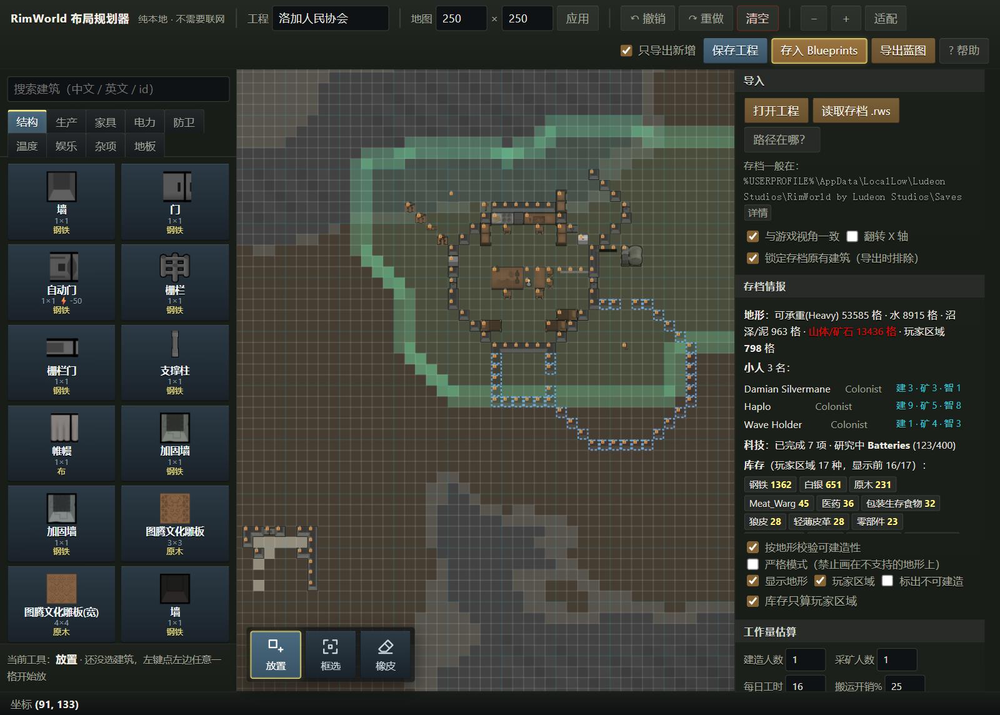
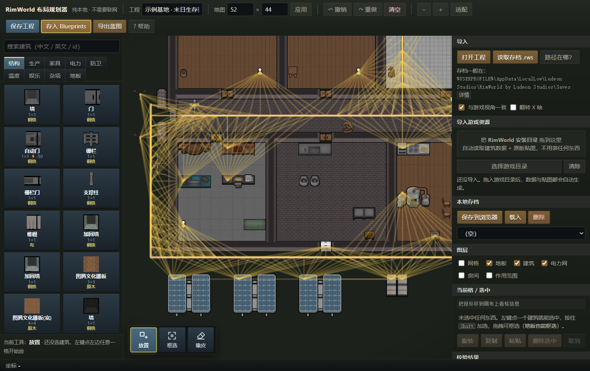
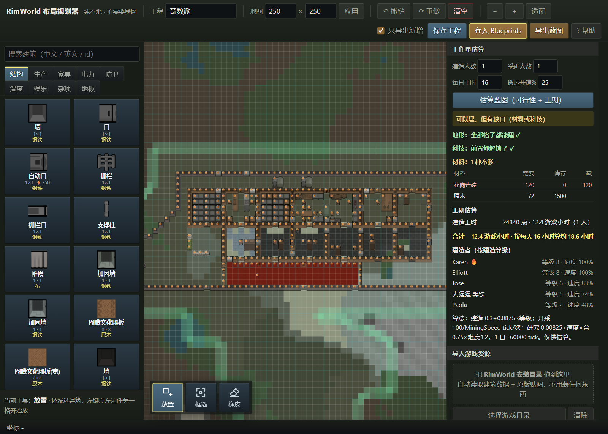
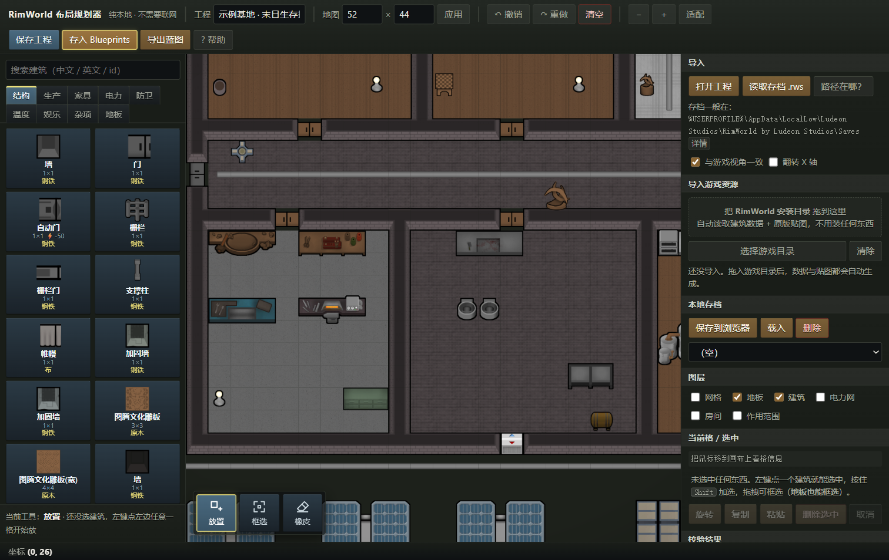
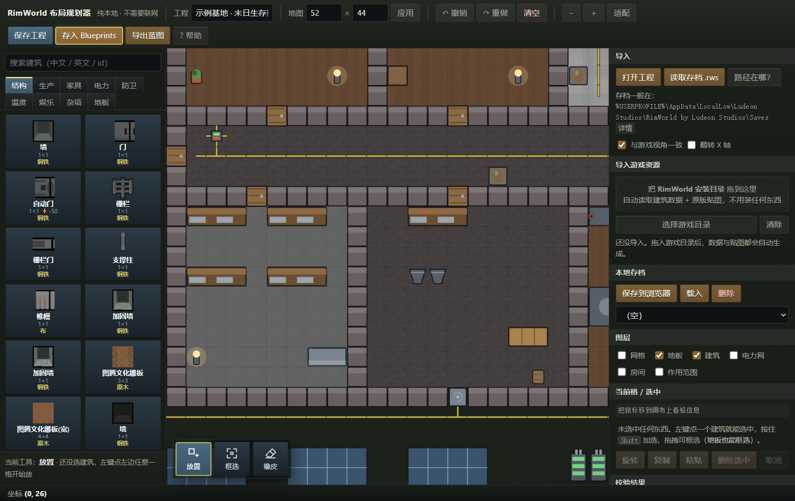

# RimWorld 布局规划器（本地离线版）

**不开游戏、不联网，在浏览器里把 RimWorld 基地画好、跑一遍校验、再导出成蓝图丢回游戏。**

**中文** · [English](README.en.md)




---

## 这是什么

一个用浏览器打开就能用的 **RimWorld 基地布局规划工具**：按游戏真实的格子占地摆放建筑，跑一遍布局校验，最后导出一个 `.xml` 蓝图丢回游戏。

- **按正确占地摆放** —— 250×250（可改）网格，`R` 旋转；多格建筑（床、桌子、精密装配台）的占地会随朝向变化
- **跑布局校验** —— 占地冲突 · 电力网络 · 房间识别与空间评分 · 通路可达性 · 温控估算
- **导回游戏** —— 导出 Blueprints 模组的真蓝图 `.xml`，**带每个建筑的材质与朝向**，游戏里工人会消耗材料去建
- **读你的存档** —— 导入 `.rws` 把已经建好的基地读进来当底图继续规划；同时读出新地图**地形/山体**、**殖民者属性**、**科技进度**、**库存物资**
- **地形校验** —— 用存档里的真实地形判断能不能建：沼泽只有 Light 撑不住墙（要 Heavy）、水面要先铺桥、山体/矿石要先开采
- **工作量估算** —— 结合殖民者技能、科技前置、库存材料，算出蓝图能不能实现、要多少材料、大约几天
- **底图锁定** —— 存档原有建筑默认「锁定」：不会误删误移，导出蓝图时自动排除，只打包你新画的规划
- **全中文** —— 建筑名 / 材质名和游戏内一致（内置对照表；导入官方简中语言包后优先用官方名）
- **可选原版贴图** —— 把游戏安装目录拖进网页，画布上直接显示游戏美术；不拖也行，自动用代码绘制的矢量图

> **它不是什么**：不是 mod，不修改游戏文件，不联网，不上传任何数据。它只输出一个蓝图文件。

## 三十秒上手

三种方式，任选一种：

### ① 在线试用（零安装）

👉 **https://luwendi-qq.github.io/rimworld-planner/**

功能完整，缺点是原版贴图要你自己拖一次游戏目录（贴图数据存在你本机浏览器里）。

### ② 下载单文件版（推荐日常使用）

到 [Releases](https://github.com/luwendi-qq/rimworld-planner/releases/latest) 下载 `rimworld-planner.single.html`，**双击就能用**。

每次源码更新，GitHub Actions 会自动重新构建并更新 Releases 里的 `latest`（源码改动后无需手动发版）。

CSS 和全部 JS 都内联在这一个文件里，没有任何外部依赖（约 630 KB），可以随便拷来拷去。

### ③ clone 源码（跟进更新 / 想改代码）

```bash
git clone https://github.com/luwendi-qq/rimworld-planner.git
```

之后作者更新了，在目录里 `git pull` 一下就同步：

```bash
git pull
```

也可以直接在仓库页面点 **Code → Download ZIP**，解压覆盖旧目录。

> `img/` 原版贴图**不在仓库里**（版权原因，见下），所以 clone 下来画布是矢量图，**功能完全一样**。
> 想要 100% 原版观感，见 [docs/textures.md](docs/textures.md)，本地做一次就行。

## 功能亮点

| 功能 | 说明 |
| --- | --- |
| **绘制方式自动匹配** | 墙/栅栏/沙袋 → **方框**（拖矩形只画外圈）；门/家具/设施 → **单点**；地面 → **填充**。和游戏一致，不用手动切 |
| **不误删东西** | 已经画过的地方再放东西会被挡下来（提示「先删掉那一格」），不会默默覆盖你的规划；电缆可以埋在墙下、制冷机 / 壁灯可以贴在墙上共存 |
| **电缆自动衔接** | 按四周邻居画出接头，孤立的一格画成接线盒 |
| **材质逐物品** | 53 种材质（木/石/金属/纤维/皮革），长按左键选，和游戏一样逐个记；导入存档时一起带进来 |
| **房间指定** | 给房间指定用途（卧室 / 厨房 / 工坊 / 冷藏 / 冷冻…），校验会检查「该有的东西有没有」，并按目标温度算出要几台制冷机 |
| **布局校验** | 电力按游戏的 6 格连接规则组网算缺口；房间 flood-fill + 游戏的空间评分阈值；室外可达性 BFS |
| **存档地形** | 读取 `.rws` 的地形/山体/屋顶网格，按游戏 `terrainAffordance` 判断沼泽、水面、山体能不能建 |
| **玩家区域** | 读出游戏里的 `Area_Home`，淡绿底 + 边界显示；库存默认只统计玩家区域内的物资 |
| **工作量估算** | 结合殖民者技能、科技前置、库存材料，给出可行性、材料缺口与建造/开采/研究工期 |
| **底图锁定** | 存档原有建筑默认锁定（淡显 + 小红锁），导出蓝图时自动排除，只导出你新画的规划 |
| **房间定位** | 房间列表点击即可把视图跳到对应房间 |
| **导出图片** | 「视图 PNG」导出当前画面、「整图 PNG」自动算包围盒导出整个布局，方便分享 / 存档 |
| **常规编辑** | 框选、多选、拖动移动、复制粘贴、删除、撤销/重做（增量式，200 步，大基地也不吃内存） |
| **搜索** | 按中文 / 英文 / id 搜建筑 |

完整操作说明 → [docs/usage.md](docs/usage.md)

## 截图

### 布局校验：电力 / 房间 / 建筑清单



点右侧「运行校验」后，会列出每张电网的发电 / 耗电 / 储电与缺口（这张图里 #1 网是 2000W / 1280W，平衡），
以及每个房间的面积、空间评分、门数与制冷器够不够；下面还有建筑清单统计。
打开「电力网」图层时，画布上还会画出电缆连线（这张图为了看清基地，暂时关掉了连线）。

### 存档分析：地形 / 玩家区域 / 小人 / 科技 / 库存 / 工期



读取 `.rws` 后，右侧会多出「存档情报」和「工作量估算」两块，导入面板里还有底图锁定选项：

- **存档情报**：这张图的地形（可承重 Heavy 格数 / 水 / 沼泽 / 山体矿石）、**玩家活动区域**、殖民者技能、科技完成度、库存材料。库存可在「玩家区域」和「全地图」之间切换。
- **工作量估算**：点一下「估算蓝图」，会按你选的人数与工时算出——地形够不够、科技缺哪几项、材料差多少、建造/开采/研究各要多久，并给出「能建 / 有条件 / 建不了」的结论。
- **底图锁定**：存档原有建筑默认锁定（图上淡显 + 左上角 🔒），导出蓝图时自动排除；点「全部解锁」才会连它们一起导出。
- **房间定位**：点房间列表里的任意一条，视图会直接跳到那个房间。

### 首次打开：导入游戏资源

单文件版第一次打开会弹窗提示导入 RimWorld 安装目录：

- 导入后能得到精确尺寸 / 造价 / 工时 / 科技前置、地形与山体识别、原版贴图
- 不导入也能用，只是部分数值是参考值、画布使用矢量图
- 可以勾「不再提醒」；右侧「导入游戏资源」面板始终保留，随时能再导

### 原版贴图 vs 矢量图

同一个区域，上面是游戏原版贴图，下面是拿掉 `img/` 后的矢量图兜底。
**形状、占地、朝向完全一致**，只是没有游戏美术：





## 把布局导回游戏

点顶栏「**导出蓝图**」得到一个 `.xml`，放进 RimWorld 的 Blueprints 文件夹：

| 平台 | 路径 |
| --- | --- |
| Windows | `%USERPROFILE%\AppData\LocalLow\Ludeon Studios\RimWorld by Ludeon Studios\Blueprints\` |
| Linux | `~/.config/unity3d/Ludeon Studios/RimWorld by Ludeon Studios/Blueprints/` |
| macOS | `~/Library/Application Support/RimWorld/Blueprints/` |

游戏里用蓝图按钮载入即可，工人会消耗材料开建。需要 **Blueprints** 模组（1.7 用 `Blueprints - 1.7 Waylith (Unofficial)`，工坊 ID `3819556044`）。

> **更省事**：顶栏点「**存入 Blueprints**」，选一次那个文件夹，之后一键直接写进去，不用自己翻路径。
> 设定过文件夹后再点「导出蓝图」也会直接写进同一个文件夹，不会额外下载一份。
> 蓝图文件名默认用工程名；**读取存档后会自动改成存档里的殖民地名**（例如「洛加人民协会」）。

细节和存档导入 → [docs/import-export.md](docs/import-export.md)

## 关于数据准确性（重要）

内置数据库是**人工整理的参考值**：格子尺寸基本可靠，但少数条目方向/数值可能随版本变化，这类条目界面上会标 `?` 提醒你核对。

**想要精确数据**（尺寸 / 耗电 / 发电 / 储电直接来自游戏 `Defs`）：

- 最省事：把 **RimWorld 安装目录拖进网页右侧的「导入游戏资源」**，浏览器自己读完就精确了；
- 或跑一次 `python tools/extract_defs.py "<游戏目录>"`，生成 `js/buildings.generated.js`。

两条路都**只读你本机的数值定义**，输出的是尺寸/电力表格，不包含也不分发任何游戏美术资源。

三种喂数据的方式（含只拷 XML 的省流量做法）→ [docs/data.md](docs/data.md)

## 常见问题

<details>
<summary><b>画布上只有灰色形状，没有游戏贴图？</b></summary>

`img/` 贴图不存在，工具自动退回了矢量图，功能不受影响。
想要原版贴图：把游戏安装目录拖进右侧「导入游戏资源」，或跑一次 `tools/extract_textures.py`。
见 [docs/textures.md](docs/textures.md)。
</details>

<details>
<summary><b>「保存到浏览器」按钮点了没反应？</b></summary>

`file://` 下的 localStorage 在部分浏览器（尤其 Firefox）会被限制。用顶栏的「**保存工程**」导出文件即可，效果一样，而且更保险。
</details>

<details>
<summary><b>导入游戏目录后，某些建筑还是标着 <code>?</code>？</b></summary>

说明这个建筑在你装的那套 DLC 里不存在（或 1.7 已移除）。工具保留内置参考值让你继续用，但会标 `?` 提醒你核对。
详见 [docs/data.md](docs/data.md)。
</details>

<details>
<summary><b>导入游戏资源要多久？</b></summary>

第一次几十秒到一两分钟，取决于你装了几个 DLC。**别切走标签页**（浏览器会节流后台页面，变慢）。结果存进 IndexedDB，下次打开直接可用。
</details>

更多 → [docs/faq.md](docs/faq.md)

## 从源码跑 / 参与开发

没有构建步骤、没有依赖 —— 直接用浏览器打开 `index.html` 就行。

重新生成单文件版（改了源码之后）：

```bash
python tools/build_single.py
```

跑测试（纯逻辑断言，node 自带测试运行器，零第三方依赖）：

```bash
node --test        # 或 npm test
```

代码结构和各文件职责 → [docs/architecture.md](docs/architecture.md)

## 文档

| 文档 | 内容 |
| --- | --- |
| [docs/usage.md](docs/usage.md) | 绘制规则、界面说明、快捷键 |
| [docs/checks.md](docs/checks.md) | 校验模型：电力 / 房间 / 温控到底怎么算的 |
| [docs/import-export.md](docs/import-export.md) | 蓝图导出、存档导入、Blueprints 路径 |
| [docs/data.md](docs/data.md) | 数据准确性、从游戏提取 defs 的三种方案 |
| [docs/textures.md](docs/textures.md) | 原版贴图的两种获取方式与还原程度 |
| [docs/architecture.md](docs/architecture.md) | 代码结构与各文件职责 |
| [docs/faq.md](docs/faq.md) | 常见问题 |

## 版权与致谢

- 本项目**不包含任何 RimWorld 游戏美术资源**。`img/` 与 `js/sprites.js` 已通过 `.gitignore` 排除，
  需你在本地从**自己购买的游戏**里提取。README 里的截图是运行效果示意。
- 左侧图标默认全部是**代码绘制的原创矢量图形**；建筑名称、格子尺寸、耗电数值等属于事实性数据，用于兼容性目的。
- 蓝图 `.xml` 格式参考 Blueprints 模组（Fluffy, MIT）的公开实现；
  内置 zstd 解码器为 [fzstd](https://github.com/101arrowz/fzstd)（MIT）。
- RimWorld 及相关名称是 Ludeon Studios 的商标，本工具是**非官方玩家工具**。

## License

[MIT](LICENSE) —— 代码与文档可自由使用、修改、分发（不含游戏美术资源）。
